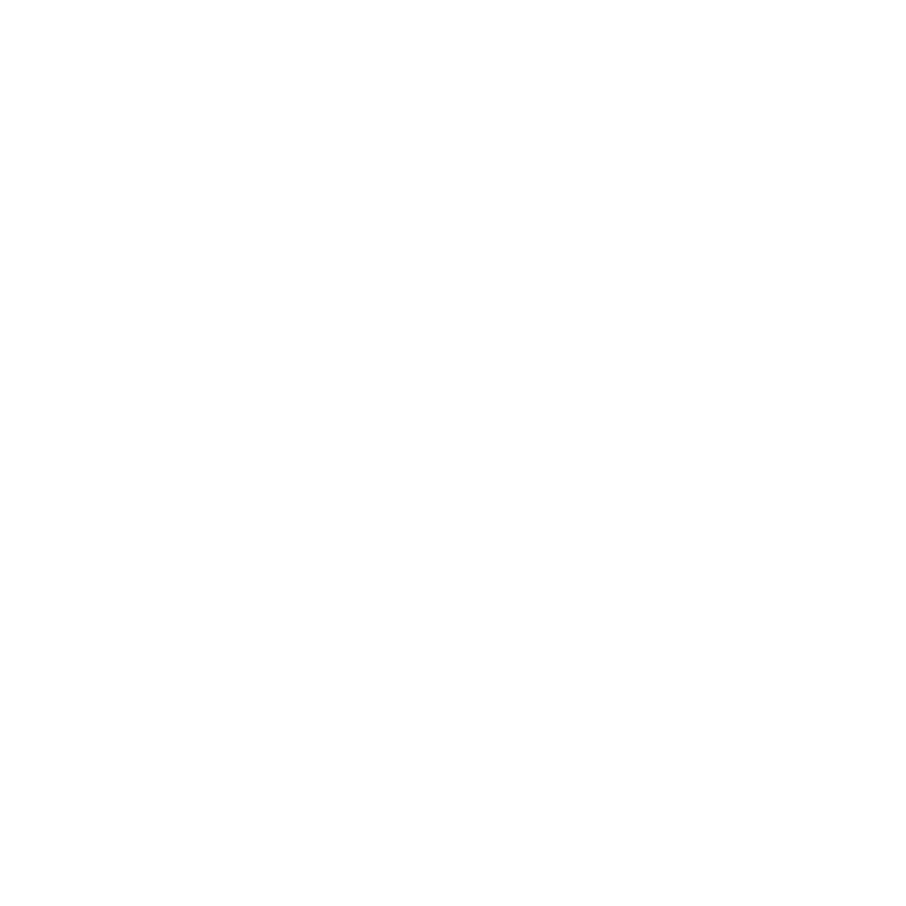

# capsnav

[](https://github.com/muu0726/capsnav/actions/workflows/release.yml)
[](LICENSE)

<p align="center">
  
</p>

**capsnav** は、CapsLockキー本来の機能を完全無効化した上で、「CapsLock + I/J/K/L」を直感的な矢印キー操作に変換する、Windows および macOS 向けの常駐型システムトレイ / メニューバーツールです。

WindowsタスクトレイおよびmacOSメニューバーにアイコンとして常駐し、GUIから簡単に動作状態の確認、有効/無効の切り替え、および終了操作が可能です。

---

## 主な特徴

- 🚫 **CapsLockの完全無効化**: CapsLock単体押し・長押しを問わず、OS標準の大文字トグル（およびキーボードLED点灯）をシステムレベルで遮断します。日本語配列（JIS 106/109キーボード）における「英数（CapsLock）」単体押下によるIME切り替えも確実に捕捉・遮断します。
- 🔄 **CapsLock状態の自動リセット**: 起動時や機能有効化時にCapsLockが既にON（大文字固定）になっていた場合、自動的にOFFへリセットし、大文字固定のスタックを防止します。
- 🧭 **IJKL ナビゲーション（ホールド判定）**: CapsLockを物理的に押している間（ホールド中）のみ、`I` / `J` / `K` / `L` を矢印キーに高速変換。キーを離すと即座に通常のキー入力に戻ります。Windows（JIS配列/US配列双方でのリアルタイム物理押下検証およびバックグラウンド解放検知）およびmacOS双方で物理ホールドに完全対応。
- 🚀 **拡張ナビゲーション（v0.6.0〜）**: `CapsLock` を押しながら `U` (Home), `O` (End), `H` (PageUp), `N` (PageDown), `Backspace` (Delete) を操作可能。ホームポジションを崩さずにテキスト編集を完結できます（ダッシュボードから個別にON/OFF可能）。
- ⚡ **修飾キー完全連携（パススルー）**: `Shift + CapsLock + I` によるテキスト範囲選択や、`Ctrl` / `Cmd` / `Alt` / `Option` と組み合わせた単語単位ジャンプ等のショートカットがそのまま動作します。
- 🛡️ **スタック防止（Anti-Stuck）多層防御機構**: CapsLockキーを離した瞬間にシミュレート中の全キーへ安全な離脱（KeyUp）イベントを送信。高速タイピング時のキー押しっぱなしを防止します。特にWindows環境では、OSドライバ層（`kbd106.dll`）でKeyUpが破棄されやすい日本語JIS配列（VK: `0xF0`、スキャンコード: `0x3A`）やUS配列（VK: `0x14`）双方に対応したイベント駆動ステートマシン、およびAlt+Tab等のフォーカス切り替え時の通常キー自動フォールバック復帰からなる**多層防御システム**を統合し、ナビゲーションモードからの確実な復帰を保証します。
- 🖥️ **システムトレイ / メニューバー常駐**:
  - Windows: タスクバー右下の通知領域（システムトレイ）に常駐。黒いコンソール画面は一切表示されません。
  - macOS: 画面上部メニューバーに常駐（Dockアイコンを出さないAccessoryモード。Template Image対応）。
- 🔘 **GUIトレイメニュー（日本語UI）**:
  - `capsnav (稼働中 / 一時停止)`: 現在の動作状態を表示。
  - `有効` / `一時停止`: チェックボックスによる機能のON/OFF切り替え。
  - `ログイン時に起動`: OS起動時の自動起動登録トグル。
  - `capsnav を終了`: バックグラウンドフックを解除して安全に終了。
- 🪶 **単一スタンドアロンバイナリ**: モノクロ透過アプリアイコン画像はビルド時にバイナリ内へ直接埋め込まれているため、外部ファイル不要で単体動作します。

---

## キー対応表

| キー入力 | 変換後の動作 | 説明 | 種別 |
| :--- | :--- | :--- | :--- |
| **`CapsLock` (ホールド)** | *(無効化 / 破棄)* | 大文字固定トグルやLED点灯は発生しません | 基本 |
| **`CapsLock押下 + I`** | **`↑` (Up Arrow)** | 上へ移動 | 基本 |
| **`CapsLock押下 + J`** | **`←` (Left Arrow)** | 左へ移動 | 基本 |
| **`CapsLock押下 + K`** | **`↓` (Down Arrow)** | 下へ移動 | 基本 |
| **`CapsLock押下 + L`** | **`→` (Right Arrow)** | 右へ移動 | 基本 |
| **`CapsLock押下 + U`** | **`Home`** | 行頭 / 文頭へ移動 | 拡張 (ON/OFF可) |
| **`CapsLock押下 + O`** | **`End`** | 行末 / 文末へ移動 | 拡張 (ON/OFF可) |
| **`CapsLock押下 + H`** | **`PageUp`** | 1ページ上へスクロール | 拡張 (ON/OFF可) |
| **`CapsLock押下 + N`** | **`PageDown`** | 1ページ下へスクロール | 拡張 (ON/OFF可) |
| **`CapsLock押下 + Backspace`** | **`Delete`** | カーソル右側の文字を削除 | 拡張 (ON/OFF可) |
| **`Shift + CapsLock押下 + I/J/K/L/U/O`** | **`Shift + ↑ / ← / ↓ / → / Home / End`** | テキスト等の範囲選択 | 組み合わせ |
| **`Ctrl / Cmd + CapsLock押下 + J/L`** | **`Ctrl / Cmd + ← / →`** | 単語単位のカーソルジャンプ | 組み合わせ |

> [!NOTE]
> CapsLockを押下しながら上記以外のキー（例: `A` や `Space`）を入力した場合は、通常の入力としてそのまま通過します。CapsLockキーを離すと即座に通常のキー入力に戻ります。

---

## アプリ画面（GUIダッシュボード） & オン/オフ スイッチ

起動時、直感的に操作できるモダンなダッシュボード画面が表示されます。

- 🟢 **CapsLock 機能オン/オフ スイッチ**:
  - **ON（有効）**: CapsLock本来の機能（大文字トグル・キーボードLED点灯）をシステムレベルで**完全に無効化**します。CapsLockキーは組み合わせキーとしてのみ動作します。
  - **OFF（無効）**: CapsLock本来のキー動作（大文字ロックの切り替え）に戻り、全キーが通常の文字入力となります。
- 🟣 **拡張ナビゲーション スイッチ（Home / End / PgUp / PgDn / Delete）**:
  - **ON（有効）**: `CapsLock` と `U/O/H/N/Backspace` の組み合わせでカーソル移動・削除が可能になります。
  - **OFF（無効）**: 基本の `IJKL` 矢印キーのみが動作し、`U/O/H/N/Backspace` は通常入力のままとなります。
- 🗺️ **インタラクティブなキーマップ図解**:
  - 矢印キー（青）、拡張ナビゲーション（紫）、前方削除（赤）がひと目でわかるキー配置マップ。拡張ナビゲーションをOFFにすると自動的に減光表示されます。
- ⚡ **お試しテスト入力欄（Try it out!）**:
  - 画面内に入力枠が用意されており、その場で `CapsLock + IJKL` や `U/O/H/N/Backspace` を入力してカーソル移動や編集をテスト・体感できます。
- 🛡️ **二重起動（多重起動）防止**:
  - 既に起動している場合は多重起動せず、常に1つのインスタンスのみが安全に稼働します。
- 💡 **「×」ボタンとタスクトレイ常駐**:
  - ウィンドウ右上の「×」ボタンを押してもアプリは完全終了せず、**タスクトレイ（画面右下の通知領域）に最小化されて常駐**します。
  - 再度画面を開くには、タスクトレイアイコンをクリックするか、右クリックメニューから **「ダッシュボードを開く」** を選択してください。

---

## トレイメニューの操作方法

タスクバー右下の通知領域アイコン（macOSではメニューバーアイコン）を右クリックするとメニューが表示されます。

```text
┌───────────────────────────────────────────┐
│  ダッシュボードを開く                     │  <- 設定画面を表示
│  capsnav (稼働中)                         │  <- 動作状態（クリック不可）
├───────────────────────────────────────────┤
│  ✔ 有効 (CapsLock無効化 & IJKL)           │  <- 機能の有効/無効トグル
│  ✔ ログイン時に起動                       │  <- ログイン時自動起動の登録/解除
├───────────────────────────────────────────┤
│  capsnav を終了                           │  <- 安全に完全終了
└───────────────────────────────────────────┘
```

- **ダッシュボードを開く**: ダッシュボード設定画面を最前面に表示します（トレイアイコンの左クリックでも表示可能）。
- **有効 (CapsLock無効化 & IJKL)**: チェックを外すと、CapsLock本来の機能に戻ります（GUI画面のスイッチと双方向同期）。
- **ログイン時に起動**: チェックを入れると、OS起動（ログイン）時に `capsnav` が自動起動するように登録されます（Windows: レジストリ、macOS: LaunchAgents）。チェックを外すと自動起動の登録が解除されます。
- **capsnav を終了**: フックを安全に解除してアプリを完全に終了します。

---

## インストール & 初回実行手順

### 1. GitHub Releases からダウンロード

[GitHub Releases](https://github.com/muu0726/capsnav/releases) より、最新バイナリをダウンロードしてください。

- **Windows**: `capsnav-windows-x86_64.exe`
- **macOS**: `capsnav-macos-universal`（Apple Silicon / Intel 両対応のUniversal Binary）

---

### 2. Windows での手順

1. ダウンロードした `capsnav-windows-x86_64.exe` を任意の固定フォルダ（例: `C:\Tools\capsnav\` など）に配置します。
2. ダブルクリックして実行すると、タスクバー右下の通知領域にアイコンが表示されます。
3. トレイメニューの **「Launch at Startup」** にチェックを入れると、次回以降のPC起動時に自動で常駐します。

#### ⚠️ Windows Defender / SmartScreen 警告が出た場合
未署名の個人開発バイナリであるため、初回実行時に「WindowsによってPCが保護されました」という青い警告画面が表示される場合があります:
1. 警告画面内の **「詳細情報」** をクリックします。
2. 右下に現れる **「実行」** ボタンをクリックします。

---

### 3. macOS での手順

1. ターミナルを開き、ダウンロードしたバイナリに実行権限を付与します:
   ```bash
   chmod +x capsnav-macos-universal
   ```

2. 実行します:
   ```bash
   ./capsnav-macos-universal
   ```

#### 🛡️ macOS アクセシビリティ許可の自動誘導
キーボードイベントの低レベルフック（`CGEventTap`）にはアクセシビリティ権限が必要です。
`capsnav` は起動時に権限がないことを検知すると、ダイアログ表示とともに**自動的に「システム設定 > プライバシーとセキュリティ > アクセシビリティ」を開きます**。
> 「capsnav の実行にはアクセシビリティ権限が必要です。『システム設定 > プライバシーとセキュリティ > アクセシビリティ』で capsnav を許可してください。」

1. 開いた設定画面のリスト内で **「capsnav」**（または実行中のターミナル）のトグルを **オン** にします。
2. 許可後、再度実行してください。

#### ⚡ macOS での Hyperキー（仮想修飾キー）連携方式
macOSのハードウェア仕様上、CapsLockキーはOS深部で大文字固定トグルとして動作し、遅延や入力切替競合が生じます。
`capsnav` は起動時に macOS 標準の `hidutil` を介して CapsLock を仮想キー **`F18`（Hyperキー）** へ自動リマップします：
- **CapsLock本来の大文字固定トグル・LED点灯を完全遮断**: 純粋なホールド型修飾キーとして動作します。
- **瞬時のキー変換**: 物理的な押下・解放がレイテンシゼロで矢印キー変換に連動します。
- **自動クリーンアップ**: アプリ終了時や機能無効化時には、キーボードマッピングが自動で初期状態へ復元されます。

#### ⚠️ macOS Gatekeeper 警告（「開いていません」「開発元を検証できないため開けません」）が出た場合
未署名バイナリに対する macOS のセキュリティ機能によるものです。ターミナルで隔離属性を解除するか、システム設定から許可してください:
- **ターミナルで解除する場合（推奨）**:
  ```bash
  xattr -d com.apple.quarantine capsnav-macos-universal
  ```
- **システム設定から許可する場合**:
  「システム設定 > プライバシーとセキュリティ」下部の「このまま開く」をクリックしてください。

---

## アイコンデザインについて

本ツールのアイコンは、macOS のメニューバー（Template Image によるライト/ダーク自動反転対応）や Windows のシステムトレイに美しく調和するよう、白黒・モノクロ（グレースケール透過）デザインを採用しています。
中央のキーキャップ（CapsLockシンボル `⇪`）から上下左右の4方向へシャープなナビゲーションシェブロンが広がる視認性の高いベクター調デザインとなっており、`assets/icon.png` としてプロジェクト内に格納され、ビルド時に `include_bytes!` マクロによってバイナリ内に直接埋め込まれているため、ランタイムで追加のアセットファイルを読み込む必要がありません。

---

## ソースコードからのビルド

```bash
# クローン
git clone https://github.com/muu0726/capsnav.git
cd capsnav

# デバッグ実行 (コンソールログ表示あり)
cargo run

# テストスイートの実行 (単体テスト & 統合テスト)
cargo test

# リリースビルド (WindowsではコンソールなしのGUIモード)
cargo build --release
```

macOS Universal Binary のビルド:
```bash
rustup target add aarch64-apple-darwin x86_64-apple-darwin
cargo build --release --target aarch64-apple-darwin
cargo build --release --target x86_64-apple-darwin

lipo -create -output capsnav-macos-universal \
  target/aarch64-apple-darwin/release/capsnav \
  target/x86_64-apple-darwin/release/capsnav
```

---

## ライセンス

本プロジェクトは [MIT License](LICENSE) の下で公開されています。
